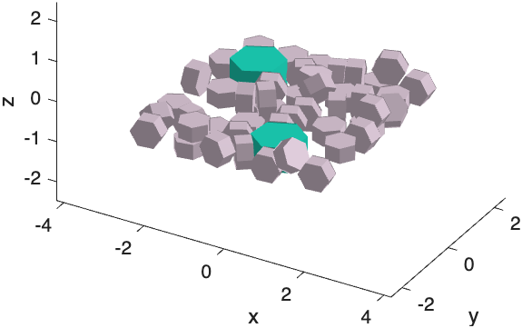

# stlextractor

**stlextractor** is a MATLAB package that takes a single STL file containing a
*packing* of many hexagonal prisms and splits it into the individual
particles, recovering each prism's geometric parameters: position, axis
(normal), radius, thickness, volume and vertices.

{ width="560" }

## What it does

- **Reads** a (large) STL mesh, typically exported from a 3-D modelling tool
  such as [Blender](https://www.blender.org/).
- **Separates** the mesh into connected components, one per particle, and
  recognises each one as a hexagonal prism.
- **Describes** every particle as a [`HexagonalPrism`](api/HexagonalPrism.md),
  and the whole packing as an [`ExtractedPacking`](api/ExtractedPacking.md)
  with bounding box, filling fraction and alignment statistics.
- **Filters** the packing (z-limits, bounding box, percentage cutoffs) to keep
  only the particles of interest.
- **Exports** the result: one STL file per particle, a 3-D plot, or a JSON
  file via [`STLextractToJSON`](api/STLextractToJSON.md), which is convenient
  for command-line pipelines.

## Why

Packings of particles are easy to *generate* in a geometric modelling tool,
but simulations often need to assign different properties to each particle
(e.g. a mechanical or magnetic property that depends on radius or
orientation). stlextractor turns the purely geometric STL into structured
per-particle data that MATLAB code — or any program that reads JSON or STL —
can work with.

## Limitations

- **Hexagonal prisms only.** No other particle shape is currently recognised.
- **One connected component per particle.** Particles must not touch or share
  vertices/edges. Each component must contain exactly one group of 12
  mutually parallel edges (the prism's lateral edges); otherwise extraction
  fails with an `STLExtractor:InvalidParticleGeometry` error.
- **Platform/version status.** Developed on macOS and Linux; Windows support
  and the minimum MATLAB release are not yet verified
  ([#14](https://github.com/cmt-dtu-energy/stlextractor/issues/14),
  [#15](https://github.com/cmt-dtu-energy/stlextractor/issues/15)).

## Next steps

- [Install](installation.md) the package.
- Run the [Quickstart](quickstart.md) to extract your first packing in a minute.
- Work through the [Tutorial](tutorial.md) for filtering, saving and JSON export.
- Browse the [API Reference](api/index.md).
